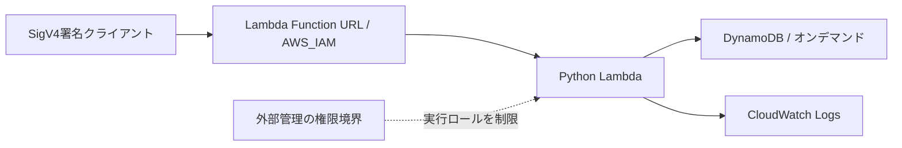

# Content API — Terraform / CloudFormation / AWS CDK

[](https://github.com/nilab-llc/content-api-iac-portfolio/actions/workflows/check.yml)

同じ小型コンテンツAPIを3方式のIaCで構築し、設定変更・データ保持・障害訓練と復旧・削除再構築を実環境で確認した個人開発ポートフォリオです。商用の開発・本番運用実績とは区別しています。

## 確認したこと

2026-10-28〜29、AWS東京リージョンで3方式すべてを検証しました。

| 検証 | Terraform | CloudFormation | AWS CDK |
|---|---|---|---|
| 6リソースの構築 | 成功 | 成功 | 成功 |
| 未認証拒否・認証済み登録と取得 | 403 / 201 / 200 | 403 / 201 / 200 | 403 / 201 / 200 |
| メモリ128→256MB・ログ7→14日 | 成功 | 成功 | 成功 |
| 変更後の記事ID・日時・本文等の保持 | 全項目一致 | 全項目一致 | 全項目一致 |
| 訓練503・原因ログ・設定復旧 | 確認 | 確認 | 確認 |
| 6件削除→同じコードから再構築 | 成功 | 成功 | 成功 |
| 記事の再投入・最終差分なし | 確認 | 確認 | 確認 |

CDK版はPython Constructから生成したテンプレートをAWS CLIのCloudFormation Change Setで反映しています。`cdk deploy` / `cdk bootstrap` を実行した実績には含めません。

- [3方式の比較と判断理由](docs/comparison.md)
- 実測記録：[Terraform](verification-records/terraform-lifecycle.md) / [CloudFormation](verification-records/cloudformation-lifecycle.md) / [CDK](verification-records/cdk-lifecycle.md)
- [ローカル検証：49テストと生成物検証](verification-records/cdk-local-checks.md)

## 構成



1方式につきLambda・Function URL・DynamoDB・ロググループ・実行ロール・インラインポリシーの6リソース。既定はPython3.13、128MB、timeout10秒、ログ7日、訓練OFFです。3方式は同じアカウント・東京の別名環境で検証しました。

権限境界とSSO構築権限はスタック外で管理します。Lambdaには対象テーブルのGetItem/PutItemと、対象ログのCreateLogStream/PutLogEventsだけを付与。URL呼び出しはIAM認証とURL経由条件で制限しています。

## API

| リクエスト | 正常応答 | 主な条件 |
|---|---|---|
| GET /health | 200 | 生存確認。DBの可用性は判定しない |
| POST /articles | 201・記事全体 | title 1〜200文字、content 1〜10000文字 |
| GET /articles/{article_id} | 200・記事全体 | 不正ID400、未登録404 |

全ルートでAWS側のIAM認証が必要です。未認証はLambda到達前に403となります。IDはUUIDの32桁hex、日時はUTC。登録は条件付きPutItem、取得は強い整合性のGetItemです。記事の一覧・更新・削除は実装していません。

本文・認証情報をアプリログに出さず、アプリ／依存処理の例外はログへ記録し応答を503にします。訓練フラグではDynamoDB呼び出し前に意図的なエラーを起こし、ログ確認と設定復旧を練習しています。

## ディレクトリ

| 場所 | 内容 |
|---|---|
| app/handler.py | 3方式で共通のアプリ |
| infra/terraform/ | HCL・モック試験・プロバイダーロック |
| infra/cloudformation/ | 生成済みJSON・パラメータ・手順 |
| infra/cdk/ | Python Construct・生成済みJSON・手順 |
| scripts/ | 生成、一致確認、明示実行する実環境検証 |
| tests/ | 共通API、埋め込みコード、CDK構成、権限と記録の保護 |
| permissions/ | 対象限定の権限と境界。段階別の履歴を保持 |
| verification-records/ | 日付付きの公開用検証要約 |

## ローカル確認とCI

Python3.13・Node24を使います。CDKとCloudFormationの生成／試験はAWS認証不要です。

```sh
python -m pip install -r requirements-cfn.txt -r requirements-cdk.txt
python scripts/build_cloudformation.py --check
python scripts/synth_cdk.py --check
python scripts/build_cdk_permissions.py --check
python -m unittest discover -s tests -v
cfn-lint infra/cloudformation/template.json --regions ap-northeast-1
cfn-lint infra/cdk/template.json --regions ap-northeast-1

cd infra/terraform
terraform fmt -check -recursive
terraform init -backend=false -input=false
terraform validate
terraform test -no-color
```

GitHub Actionsはこれらのテスト・構成検証だけを実行します。AWSキーやデプロイ権限は設定せず、自動デプロイもしません。Terraform試験はAWSプロバイダーをモック化したplanで、実環境の検証とは区別します。

生成物を更新する場合は `python scripts/build_cloudformation.py` / `python scripts/synth_cdk.py` を実行し、共通ソースと一致することを確認します。実環境確認スクリプトはCIから呼ばれず、記事登録や料金が発生する操作には明示指定が必要です。

## AWSへの反映と再現

- [CloudFormation手順](infra/cloudformation/README.md)
- [CDK手順](infra/cdk/README.md)
- [Terraformの権限・前提](permissions/README.md)

配備先のアカウント・名前・外部管理の境界は今回の個人検証環境に固定されています。別の環境で試すときは、対応するIaC・権限・テスト・検証スクリプトをまとめて変更し、plan / Change Setと料金を確認してください。

このリポジトリにTerraform状態は含めません。既存環境の状態を持たずにapplyすると、同名リソースと衝突します。既存環境を操作する場合は元の非公開状態を使い、勝手に取り込み・再作成しないでください。

権限案は保存時点のスナップショットです。SSOへ反映する前に現行内容と照合し、既存の無関係な権限を上書きしないでください。現在の3方式統合案はpermissions/cdk/にあります。

## 範囲と限界

- 削除再構築は環境再作成とタイトル・本文の再登録です。元の記事ID・日時を保持するDB復元ではありません。URLも変わりました。
- 503は訓練フラグによるものです。実際のAWS障害からの復旧、RTO保証、性能改善、同時負荷、本番運用経験を証明するものではありません。
- 最終の差分なしはplan / Change Setの確認です。全リソースのドリフト検証ではありません。
- 料金の実測は未確認です。環境の稼働・データとログの保持には利用料金が発生し得ます。デプロイ・削除は手動のCLI工程です。
- 状態・plan・認証キャッシュ・生のAPI記録・記事退避は公開していません。公開記録はその実施日時点の結果で、現在の稼働状態を保証しません。
